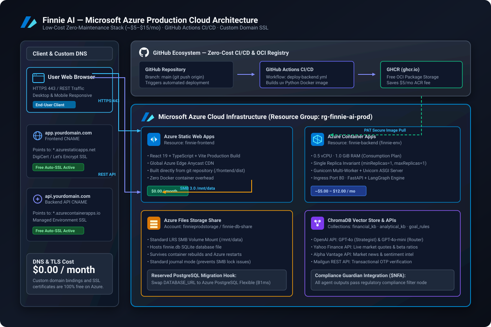
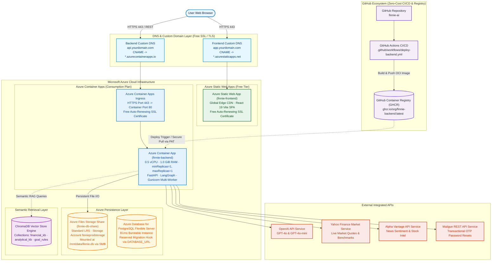

# Finnie AI — Deployment & Cloud Infrastructure Guide

This document is the authoritative guide for containerizing, configuring, and deploying Finnie AI to cloud infrastructure (Azure App Service, AWS Fargate, GCP Cloud Run, or Kubernetes).

---

## 1. Business Context & Operational Rules

- **12-Factor App & Cloud-Native Philosophy**:
  - The application is vendor-agnostic and fully containerized using Docker.
  - Zero hardcoded credentials or environment-specific URLs.
  - Stateless scaling: JWT authentication allows scaling backend worker replicas horizontally across cloud instances.
- **Persistent Data**:
  - SQLite data file (`finnie.db`) is mounted on Azure persistent storage (`/home/finnie.db`).
  - Swapping to managed cloud PostgreSQL (e.g. Azure Database for PostgreSQL) requires only setting `DATABASE_URL` in environment variables with zero code changes.

---

## 2. Diagrammatic Architectural Representation

<p align="center">
  
</p>



### Key Cloud Decisions & Reference Matrix

| Component | Target Service | Cost Strategy | Architecture Notes |
|---|---|---|---|
| **Frontend Hosting** | Azure Static Web Apps | **$0.00** (Free Tier) | Global CDN edge caching, automatic GitHub builds (`dist`), custom domain `app.yourdomain.com` with free auto-renewing SSL. |
| **Container Registry** | GitHub Container Registry (`ghcr.io`) | **$0.00** (Free Tier) | Built via GitHub Actions (`deploy-backend.yml`), eliminating Azure Container Registry ($5/mo) costs. |
| **Backend Compute** | Azure Container Apps | **~$5.00 – $12.00 / mo** | Serverless Linux container (0.5 vCPU, 1.0 GiB RAM), Gunicorn/Uvicorn workers, custom domain `api.yourdomain.com` with free auto-renewing SSL. |
| **Database Storage** | Azure Files (Standard LRS) | **~$0.10 – $0.30 / mo** | Persistent SMB file share mounted at `/mnt/data/finnie.db`. Single-replica invariant (`minReplicas: 1, maxReplicas: 1`) prevents SQLite file-locking conflicts. |
| **Future Database Hook** | Azure PostgreSQL Flexible Server | Ready for Zero-Code Swap | Swap `DB_PATH` for `DATABASE_URL=postgresql://...` to enable multi-replica horizontal scaling (`maxReplicas > 1`). |
| **Vector Store** | ChromaDB Cloud / Local Volume | **$0.00** (Free Tier / Mounted) | Regulatory, analytical, and goal planning semantic vector embeddings. |
| **Custom Domains & SSL** | Domain Registrar DNS | **$0.00** (Azure Managed SSL) | CNAME records point `app.yourdomain.com` and `api.yourdomain.com` with automated TLS certificate generation. |

---

## 3.  Detailed Technical Implementation

### A. Gunicorn Multi-Worker Container (`backend/Dockerfile`)
The backend is packaged using Astral's official `uv` slim image for minimal build context and ultra-fast container startup:

```dockerfile
# Multi-worker Gunicorn server configuration
CMD ["sh", "-c", "exec gunicorn main:app -w ${WORKERS:-2} -k uvicorn.workers.UvicornWorker -b 0.0.0.0:8000 --timeout 120"]
```

### B. Environment Variables & Configuration
Set these in your cloud provider's app settings (Azure App Settings / AWS Secrets):

| Variable Name | Example Value | Purpose |
|---|---|---|
| `DATABASE_URL` | `sqlite:////home/finnie.db` | Points to persistent disk mount |
| `ALLOWED_ORIGINS` | `https://finnie.azurewebsites.net` | Comma-separated CORS whitelist |
| `JWT_SECRET_KEY` | `your-secure-random-key` | Signs HMAC-SHA256 JWT bearer tokens |
| `OPENAI_API_KEY` | `sk-...` | Powers LangGraph Supervisor & Agent Nodes |
| `WORKERS` | `2` | Number of Gunicorn worker processes |

### C. Docker Compose (Local Staging)
```bash
# Build and run complete multi-container stack locally
docker compose up --build -d
```

---

## 4.  Resilience, Edge Cases & Verification

- **Healthcheck Probe**:
  - `GET /health` runs without touching any external LLM or scraper, serving as an instant, zero-cost liveness probe for load balancers.
- **Bundle Optimization**:
  - `.dockerignore` excludes `.venv/`, `chroma_data_local/`, and local caches, shrinking the container footprint to < 300MB.
