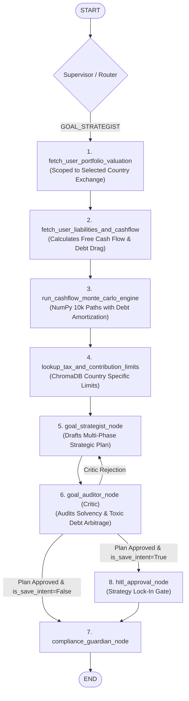

# Feature Spec: SPEC-11 — Cash-Flow & Liability-Aware Financial GPS

> **Status**:  **BASELINE / PRODUCTION VERIFIED**  
> **Author**: Antigravity & Lead Engineer  
> **Scope**: Full-Stack (Backend Models, Cash-Flow Simulation Engine, LangGraph Multi-Agent, React 19 Twin Visualizations)  
> **Target Release**: v0.9.0 (Phase 9)  
> **Prerequisites**: SPEC-03 (Goal Strategist Baseline), SPEC-10 (Autonomous Financial GPS)

---

## 1. Business Objective & Domain Rules

### 1.1 Problem Statement
While the current Goal Planner successfully executes 10,000-scenario Monte Carlo simulations against investment portfolios, it operates under an **asset-only assumption**:
1. **Blind to Debt Drag**: An investor committing $1,000/month to equities while carrying $8,000 in credit card debt at 24% APR loses -16% in net guaranteed yield.
2. **Static Savings Fallacy**: Monthly contributions are treated as a flat, unvarying input, ignoring the cash-flow release when a 3-year auto loan or student loan is paid off.
3. **Cash-Flow Solvency Risk**: Users can enter unrealistic savings commitments that exceed their actual take-home pay minus living expenses and debt servicing.
4. **Multi-Region Portfolio Ambiguity**: Global investors with holdings across multiple geographic exchanges (e.g. US NYSE vs. Indian NSE) lack an upfront country selector to cleanly scope their currency, tax rules, and active holdings.

### 1.2 Core Domain Rules & Financial Invariants

1. **Mandatory Upfront Country Scoping (Prerequisite)**:
   - Before calculating or viewing a goal roadmap, the user **must select their Country of Residence / Plan Jurisdiction** (e.g., [US] USA, [IN] India, [UK] UK, [CA] Canada).
   - **Portfolio Filtering**: `fetch_user_portfolio_valuation` automatically isolates holdings matching the selected country's exchange (e.g., NASDAQ/NYSE for USA, NSE/BSE for India, LSE for UK) and denominations in local currency ($, ₹, £).
   - **Automatic Portfolio Ingestion**: If regional holdings exist, the total market valuation becomes the initial capital ($S_0$) and historical holdings variance defines $\sigma$. If 0 regional holdings exist, $S_0 = 0.0$ and a standard 15.0% broad-market benchmark equity standard deviation is applied for future savings.

2. **Dynamic Net Investable Cash Flow**:
   - Monthly investable capacity is mathematically constrained by the user's cash-flow profile:
     $$\text{Free Cash Flow} = \text{Monthly Take-Home} - \text{Fixed Living Costs} - \text{Discretionary CC Spend} - \sum \text{Active Loan EMIs}$$
   - **Solvency Circuit Breaker**: If $\text{Committed Savings} > \text{Free Cash Flow}$, the system displays a prominent deficit alert and triggers an agentic solvency review.

3. **High-Interest Debt Avalanche Rule**:
   - Debts with an $\text{APR} \ge 10.0\%$ (credit cards, personal loans) are classified as **Toxic Debt Drag**.
   - The multi-agent optimizer automatically allocates available savings to eliminate toxic debt in **Phase 1** before accelerating equity investments.

4. **Dynamic Loan Payoff Step-Up**:
   - As each loan reaches its maturity (e.g., auto loan ends in Month 36), its monthly EMI is automatically added to future investable cash flow in the simulation from Month 37 onwards.

5. **Zero-Knowledge Privacy Invariant (Strict Enterprise Security)**:
   - **Zero PII to LLMs**: Name, email, user ID, bank account numbers, and credit card PANs are NEVER included in prompts.
   - **100% Local Math**: Loan amortization, free cash flow calculations, Monte Carlo simulations (NumPy), and tax ceiling lookups (ChromaDB) run 100% locally on the backend server with zero external LLM dependencies.
   - The LLM only receives anonymized mathematical aggregates to synthesize natural language text.

6. **Regulatory Compliance**:
   - Every generated strategy, roadmap, and chat refinement must route through `compliance_guardian_node` and conclude with the mandatory `$NFA` disclaimer.

---

## 2. Technical Contracts & Architecture

### 2.1 REST API Endpoints

#### A. Goal Calculation (Extended)
- `POST /goals/calculate`:
  - **Request Body**:
    ```python
    class GoalCalculateRequest(BaseModel):
        goal_name: str = "Retirement Capital"
        target_amount: float
        target_year: int
        country: str                           # "USA", "INDIA", "UK", "CANADA" (Mandatory)
        monthly_savings: float                 # Target committed savings
        
        # Optional Cash-Flow Profile
        monthly_take_home: Optional[float] = None
        fixed_living_costs: Optional[float] = None
        monthly_discretionary_spend: Optional[float] = None
        
        # Optional Liabilities List
        liabilities: Optional[List[LiabilityInput]] = []
        is_refinement: Optional[bool] = False
        selected_lever_id: Optional[str] = None # e.g. "AVALANCHE_CC", "STEP_UP_AUTO"
    ```
  - **Response Payload**:
    ```python
    class GoalCalculateResponse(BaseModel):
        confidence_score: float                # % Probability of hitting target
        status: str                            # "ON_TRACK", "CAUTION", "AT_RISK"
        
        # Chart 1: Invested Portfolio Fan Data
        years_axis: List[int]
        p05_path: List[float]
        p25_path: List[float]
        median_path: List[float]               # P50 Gross Invested Assets
        p75_path: List[float]
        p95_path: List[float]
        
        # Chart 2: Net Worth & Debt Amortization Data
        debt_amortization_path: List[float]    # Total remaining debt per year -> $0
        net_worth_median_path: List[float]     # Median Invested Assets - Remaining Debt
        debt_free_year: Optional[int]          # Exact year debt drops to $0
        total_interest_saved: float            # Projected interest saved via optimization
        
        # Cash Flow Telemetry
        free_cashflow: float
        solvency_status: str                   # "SOLVENT", "DEFICIT", "UNCONSTRAINED"
        
        # Upfront Action Levers
        action_levers: List[ActionLever]
        
        roadmap_markdown: str                  # Synthesized strategic plan
        disclaimer: str                        # $NFA notice
    ```

#### B. Liabilities Management Endpoints
- `GET /goals/liabilities`: Retrieves active user liabilities filtered by `current_user.id`.
- `POST /goals/liabilities`: Adds or updates a liability item.
- `DELETE /goals/liabilities/{id}`: Removes a liability item.

#### C. Cash Flow Profile Endpoints
- `GET /goals/cashflow`: Retrieves saved cash flow profile for `current_user.id`.
- `PUT /goals/cashflow`: Updates user's income and monthly spending profile.

---

### 2.2 Database Schema & Models (`backend/src/models/`)

Conforming strictly to [docs/DATA_MODEL.md](file:///Users/prajosh/Development/finnie-ai/docs/DATA_MODEL.md):

```python
class Liability(Base):
    __tablename__ = "liabilities"

    id: Mapped[int] = mapped_column(Integer, primary_key=True, autoincrement=True)
    user_id: Mapped[str] = mapped_column(String(64), ForeignKey("users.id", ondelete="CASCADE"), index=True)
    liability_type: Mapped[str] = mapped_column(String(32))  # CREDIT_CARD, MORTGAGE, AUTO_LOAN, STUDENT_LOAN, PERSONAL
    lender_name: Mapped[str] = mapped_column(String(100), default="Standard Lender")
    current_balance: Mapped[float] = mapped_column(Float, nullable=False)
    interest_rate_apr: Mapped[float] = mapped_column(Float, nullable=False) # e.g. 24.0 for 24%
    monthly_payment: Mapped[float] = mapped_column(Float, nullable=False)   # Minimum payment or EMI
    remaining_months: Mapped[int] = mapped_column(Integer, nullable=False)  # Months to pay off
    country: Mapped[str] = mapped_column(String(16), default="USA")
    created_at: Mapped[datetime] = mapped_column(DateTime, default=lambda: datetime.now(timezone.utc))

class UserCashflowProfile(Base):
    __tablename__ = "user_cashflow_profiles"

    id: Mapped[int] = mapped_column(Integer, primary_key=True, autoincrement=True)
    user_id: Mapped[str] = mapped_column(String(64), ForeignKey("users.id", ondelete="CASCADE"), unique=True, index=True)
    monthly_take_home: Mapped[float] = mapped_column(Float, default=0.0)
    fixed_living_costs: Mapped[float] = mapped_column(Float, default=0.0)
    monthly_discretionary_spend: Mapped[float] = mapped_column(Float, default=0.0)
    country: Mapped[str] = mapped_column(String(16), default="USA")
    updated_at: Mapped[datetime] = mapped_column(DateTime, default=lambda: datetime.now(timezone.utc), onupdate=lambda: datetime.now(timezone.utc))
```

---

### 2.3 Agent Topology & Multi-Agent Reflection Loop



#### Goal Auditor (Critic) Verification Invariants:
1. **Solvency Verification**: If the Strategist recommends saving more than the user's free cash flow without recommending spending cuts, the Auditor rejects the draft.
2. **Toxic Debt Arbitrage Check**: If the user carries credit card or personal debt > 10% APR, the Auditor mandates that **Phase 1** must explicitly prioritize debt elimination ("Debt Avalanche") before non-matched equity investing.
3. **Statutory Contribution Cap Check**: Confirms annual contributions do not exceed regional limits (e.g. US 401k $23,500, India 80C ₹1.5 Lakh) without directing the excess to taxable accounts.

---

## 3.  Frontend Presentation & UI/UX Design

The interface retains the proven **3-Column Expansive Glass Workspace** in [GoalPlanner.tsx](file:///Users/prajosh/Development/finnie-ai/frontend/src/components/Goals/GoalPlanner.tsx):

### 3.1 Column 1: Goal Targets & Cash Flow Configurator
1. **Mandatory Country Selector (Top)**:
   - Visual country dropdown with flags: [US] United States (USD), [IN] India (INR), [UK] United Kingdom (GBP), [CA] Canada (CAD).
   - Selecting a country updates all currency symbols and scopes holdings.
2. **Standard Targets**: Goal Title, Target Amount, Target Year, Committed Monthly Savings.
3. **Progressive Disclosure Accordion: "Cash Flow & Liabilities (Optional)"**:
   - **Cash Flow Inputs**: Monthly Take-Home Pay, Fixed Living Expenses, Average Credit Card / Discretionary Spend.
   - **Free Cash Flow Meter**: Live calculated badge showing:
     -  `Available Free Cash Flow: $1,850/mo` (Solvent)
     -  `[WARN] Deficit: -$350/mo (Savings Exceeds Free Cash Flow)` (Warning)
   - **Active Liabilities Table**:
     - Lists individual loans with type badge, remaining balance, APR %, and monthly payment.
     - **`+ Add Liability`** micro-button (modal or inline row) supporting Credit Card, Mortgage, Auto Loan, Student Loan, Personal Loan.
4. **Co-Located Actions**:
   - `[ Generate / Recalculate Roadmap ]`
   - `[ Lock In & Save Strategy ]` (Triggers HITL Modal)

---

### 3.2 Column 2: Center Stage (Twin Synchronized Charts & Roadmap)

Instead of cramming all data into one distorted graph, Center Stage presents **Two Dedicated, Synchronized Glass Chart Cards**:

```text
┌────────────────────────────────────────────────────────────────────────┐
│ CARD 1: INVESTED WEALTH FAN CHART (Market Probability & Volatility)   │
│ Telemetry: ● ON TRACK · 84.2% Success Probability · Target: $1M by 2045│
├────────────────────────────────────────────────────────────────────────┤
│ [Recharts Area: Cyan Median P50 + 90% Confidence Interval Band (P05-P95)│
│  Gold Dotted Line: $1,000,000 Target Milestone]                        │
└────────────────────────────────────────────────────────────────────────┘

┌────────────────────────────────────────────────────────────────────────┐
│ CARD 2: NET WORTH & DEBT AMORTIZATION (Financial Freedom Horizon)     │
│ Telemetry:  Debt-Free in 2029 (Year 4) · Interest Saved: $14,200     │
├────────────────────────────────────────────────────────────────────────┤
│ [Recharts Line: Crimson Line = Total Debt Balance ($26k -> $0)         │
│  Emerald Line = True Net Worth (Assets - Debt climbing to +$1.1M)      │
│  Highlighted Marker: Debt-Free Crossover Point]                        │
└────────────────────────────────────────────────────────────────────────┘

┌────────────────────────────────────────────────────────────────────────┐
│ UPFRONT ACTION LEVERS (Interactive Scenario Levers)                 │
├──────────────────────────────────┬─────────────────────────────────────┤
│  LEVER 1: DEBT AVALANCHE       │  LEVER 2: POST-LOAN STEP-UP       │
│ "Pay extra $150/mo on 24% Card"  │ "Auto-redirect $450 car EMI in 2028"│
│ • Debt-Free: 5 months faster     │ • Success Probability: 72% -> 89%    │
│ • Interest Saved: +$1,850        │ • Net Worth at 2045: +$64,000       │
│ [ Apply Lever ]                  │ [ Apply Lever ]                     │
└──────────────────────────────────┴─────────────────────────────────────┘

┌────────────────────────────────────────────────────────────────────────┐
│ STRATEGIC ROADMAP SYNTHESIS (Multi-Phase Milestones)                  │
├────────────────────────────────────────────────────────────────────────┤
│ • Phase 1: High-Interest Debt Cleansing (Months 1-8)                   │
│ • Phase 2: Core Tax-Advantaged Investing (Years 2-4)                   │
│ • Phase 3: Post-Amortization Accelerated Compounding (Year 4+)         │
│  SEC/FINRA Compliance Disclaimer ($NFA)                              │
└────────────────────────────────────────────────────────────────────────┘
```

#### Synchronized Crosshairs:
Hovering over Year $X$ on Card 1 automatically highlights the exact corresponding year on Card 2, giving instant cross-sectional balance sheet visibility.

---

### 3.3 Column 3: "Ask Finnie" Strategy Copilot Drawer
- Read-only multi-turn conversational history.
- Pre-baked contextual prompt chips:
  - *"Should I pay down my 6% auto loan early or invest in equities?"*
  - *"How does my 24% credit card balance impact my target year?"*
  - *"Can I claim tax deductions on my home loan interest in [Selected Country]?"*

---

## 4.  Edge Cases, Failure Modes & Resilience

| Edge Case | Risk / Failure Mode | Defense / Resolution Mechanism |
| :--- | :--- | :--- |
| **EC-1: Cash-Flow Deficit** | User commits $1,500/mo but Free Cash Flow is only $600/mo. | System flags status as `DEFICIT`, displays amber alert pill, and Auditor instructs Strategist to propose a realistic spending trim or staggered contribution schedule. |
| **EC-2: Zero Linked Stocks** | User has 0 regional stock holdings in DB. | Truth Invariant strictly enforced: $S_0 = 0.0$, applies 15.0% broad-market benchmark standard deviation, and explicitly states that 15% is an index benchmark for projected savings. |
| **EC-3: Zero Debts Entered** | User enters no liabilities. | Seamless graceful degradation: Card 2 displays pure Net Worth equal to Invested Assets ($0 debt), and Roadmap skips Phase 1 Debt Cleansing. |
| **EC-4: Negative Amortization / Infinite Loan** | User enters monthly payment below monthly interest accrual. | Mathematical validator flags: *"Monthly payment must be greater than accrued monthly interest ($XX.XX)"* before simulation dispatch. |
| **EC-5: ChromaDB Offline** | Vector database unavailable. | Deterministic fallback to verified statutory dictionary `DEFAULT_COUNTRY_STATUTES` with 0 downtime. |

---

## 5. [PASS] Acceptance Criteria & Test Plan

- [ ] **AC-1 (Upfront Country Scoping)**: Selecting Country isolates regional holdings (e.g. NSE/BSE for India, NASDAQ/NYSE for US), updates currency formatting, and pulls correct statutory tax rules.
- [ ] **AC-2 (Cash-Flow Calculation)**: $\text{Free Cash Flow} = \text{Income} - \text{Living Expenses} - \text{CC Spend} - \sum \text{EMIs}$ is computed accurately.
- [ ] **AC-3 (Debt Avalanche Prioritization)**: If user has loans with $\text{APR} \ge 10\%$, the roadmap synthesizes a Phase 1 debt elimination plan and calculates interest saved.
- [ ] **AC-4 (Post-Loan Step-Up Simulation)**: In Monte Carlo simulation, maturing loans automatically increase monthly investment contributions from their expiration month onward.
- [ ] **AC-5 (Twin Synchronized Charts)**: Column 2 renders both Card 1 (Invested Fan Chart) and Card 2 (Net Worth & Debt Paydown) with synchronized hover tooltips.
- [ ] **AC-6 (Interactive Action Levers)**: Clicking `[ Apply Lever ]` triggers instant recalculation with modified parameters.
- [ ] **AC-7 (Solvency Guardrail)**: When committed savings exceed free cash flow, the UI displays a deficit warning badge and the Goal Auditor flags the imbalance.
- [ ] **AC-8 (Zero-Knowledge Privacy)**: Unit test verifies that no PII, user IDs, or raw account numbers appear in LLM prompt messages.
- [ ] **AC-9 (Compliance Gate)**: All roadmap and chat refinement outputs conclude with the mandatory `$NFA` disclaimer.
- [ ] **AC-10 (Offline Test Suite)**: All backend unit tests in `test_unit.py` and frontend test suites pass 100%, followed by a clean `npm run build`.
